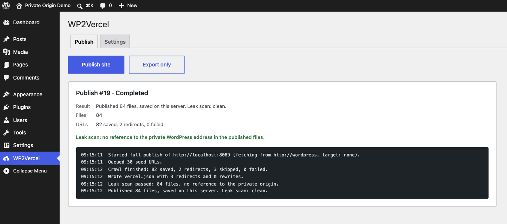
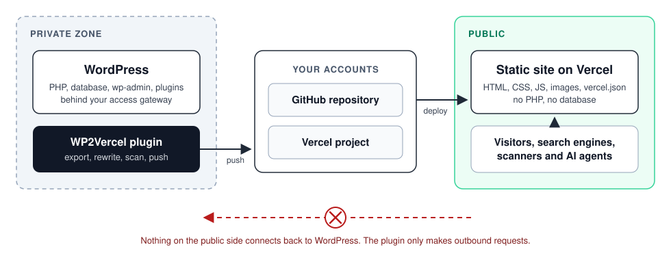
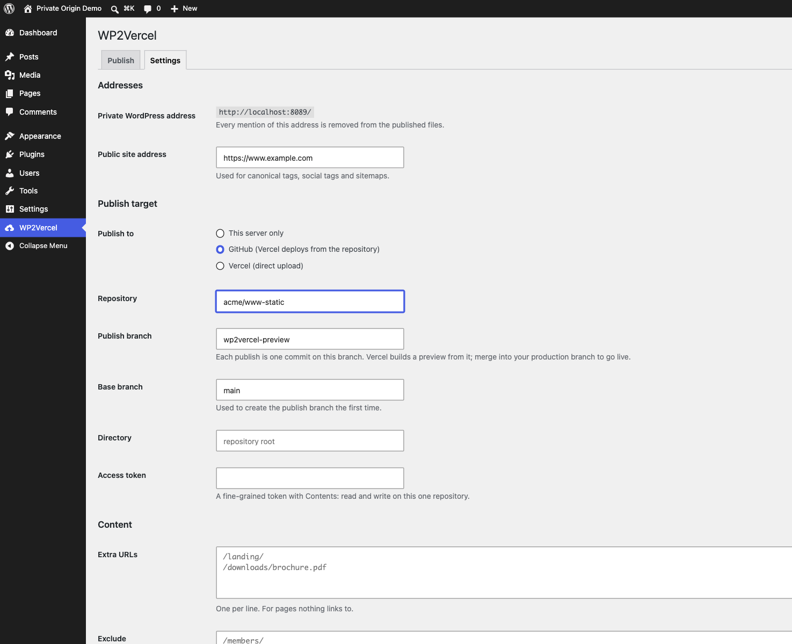

# WP2Vercel

WordPress in private. Static on Vercel.

[](https://github.com/tentenco/wp2vercel/actions/workflows/ci.yml)
[](LICENSE)


English · [繁體中文](docs/README.zh-Hant.md) · [简体中文](docs/README.zh-Hans.md) · [日本語](docs/README.ja.md) · [한국어](docs/README.ko.md)

WP2Vercel is a WordPress plugin. It exports your site as static files and publishes them to a GitHub repository or a Vercel project that you own. Visitors, search engines, scanners and AI agents reach the static copy. WordPress, PHP, the database and the login page can stay on a private network, where editors keep working the way they do today.

This repository holds the free, open-source Community edition. Paid editions add to it and are described at [wp2vercel.com/pricing](https://wp2vercel.com/pricing).

> **Status: early access.** Version 0.1.0 is the first development release. Try it on a staging copy first and read [What it does not do](#what-it-does-not-do) before you move a production site.



## How it works



1. WP2Vercel lists every published post, page and archive from the database, then fetches each one from inside the server. Pages that nothing links to are still exported.
2. Each page and asset is saved as a file. Every mention of the private WordPress address is rewritten. Links inside the site become root-relative, and canonical tags, social tags and sitemaps use the public address you set.
3. Redirects become real `301` and `302` rules in `vercel.json`. They are read from WordPress itself and from Redirection, Yoast SEO Premium, Rank Math, Safe Redirect Manager and Simple 301 Redirects.
4. A leak scan checks the finished files for the private address and for file types that should not be public. It reports the file and the line.
5. The result goes out as one commit on a GitHub branch, or as a deployment through the Vercel API. Only outbound requests are made, so WordPress does not have to accept connections from the internet.

## Features

- Full-site export, and single-page publishing from the Posts and Pages lists.
- Three publish targets: a GitHub branch (Vercel deploys from the repository), a direct Vercel deployment, or files on the server only.
- GitHub pushes upload changed files only and remove deleted ones, as one commit per publish.
- `vercel.json` with redirects, trailing-slash behaviour and basic security headers.
- Leak scan for the private address in plain, JSON-escaped and URL-encoded form.
- Resumable builds that run in the background, in the browser tab, or from WP-CLI. A build picks up where it stopped after a timeout.
- Drafts, private posts and password-protected posts are left out. So are the REST API links, `xmlrpc.php` links, the generator tag and the users sitemap.
- Access tokens are encrypted with libsodium, or kept out of the database in `wp-config.php`.
- No Composer dependencies and no build step. The plugin is plain PHP and one JavaScript file.

## Requirements

- WordPress 6.5 or newer
- PHP 8.1 or newer
- A permalink structure other than "Plain"
- For publishing: a GitHub repository connected to Vercel, or a Vercel project and token

## Install

1. Download `wp2vercel.zip` from the [latest release](https://github.com/tentenco/wp2vercel/releases/latest).
2. In WordPress, open **Plugins → Add New Plugin → Upload Plugin**, choose the zip and activate it.

With WP-CLI:

```bash
wp plugin install https://github.com/tentenco/wp2vercel/releases/latest/download/wp2vercel.zip --activate
```

## Quick start

1. Open **WP2Vercel → Settings** and enter the public site address, for example `https://www.example.com`.
2. Choose where to publish and add a token. For GitHub, create a fine-grained token with *Contents: Read and write* on the one repository you publish to.
3. If the server cannot reach its own public address (common in Docker and behind a zero-trust gateway), set the fetch address to one it can reach, such as `http://localhost`.
4. Choose **Save and test connection**.
5. Open the **Publish** tab and choose **Publish site**.



With the GitHub target, every publish is a commit on a preview branch (`wp2vercel-preview` by default). Vercel builds a preview URL from it. Merge the branch into your production branch when you are ready to go live.

## WP-CLI

```bash
wp wp2vercel publish                    # full publish
wp wp2vercel publish --post=42,57       # only these posts, into the existing output
wp wp2vercel publish --skip-deploy      # export without pushing
wp wp2vercel publish --fail-on-leak     # exit with an error when the scan finds something
wp wp2vercel status                     # recent builds
wp wp2vercel leaks                      # findings from the last build
wp wp2vercel failures                   # URLs that could not be saved
wp wp2vercel config set production_url https://www.example.com
wp wp2vercel test                       # test the connection to the publish target
```

## Keeping tokens out of the database

Define any of these in `wp-config.php` or as environment variables. The settings screen then shows the value as managed externally.

```php
define('WP2VERCEL_GITHUB_TOKEN', '…');
define('WP2VERCEL_VERCEL_TOKEN', '…');
define('WP2VERCEL_FETCH_BASIC_AUTH_PASSWORD', '…');
```

## What it does not do

A static copy removes PHP and the WordPress plugins from the public internet. That only helps if the WordPress server itself is locked down, which you do with your own network or access gateway. WP2Vercel does not do that part for you.

Things that need PHP at request time stop working on the static copy: comments, logins, carts, and forms or search that post back to WordPress. They need a replacement service or a paid edition feature.

Risks that remain:

- The WordPress server still needs updates. An attacker now has to get past your access controls first.
- Stolen editor, Git, Vercel or DNS credentials.
- A malicious script stored in content is exported as it is.
- Third-party JavaScript on your pages.
- Any API you add for forms, search or membership is a new surface to protect.

Limits of this release:

- The GitHub and Vercel publishers are covered by automated tests against the documented API responses. They have not been through a wide range of real accounts yet.
- Multisite, WordPress in a subdirectory, WPML and Polylang, and large page-builder sites have not been tested.
- Vercel accepts 2,048 routes in `vercel.json`. The plugin warns when your redirects go over that.

## Editions

| | Community (this repository) | Paid editions |
| --- | --- | --- |
| Full-site and single-page static export | Yes | Yes |
| Publish to GitHub or Vercel | Yes | Yes |
| Redirect export to `vercel.json` | Yes | Yes |
| Leak scan for the private address | Reports | Reports and can stop the publish |
| Publish only changed pages, on a schedule or after edits | | Yes |
| Wider scan rules: REST API links, author archives, version strings | | Yes |
| Publish history and rollback | | Yes |
| Search on the static site | | Yes |
| Support | GitHub Issues | Email |

Plans and what each one includes are listed at [wp2vercel.com/pricing](https://wp2vercel.com/pricing).

## Development

```bash
git clone https://github.com/tentenco/wp2vercel.git
cd wp2vercel

# unit tests (needs PHP 8.1+, PHPUnit 10+ and a WordPress checkout for the HTML API)
cd wp2vercel && WP_CORE_DIR=/path/to/wordpress phpunit

# local WordPress on http://localhost:8089 (admin / admin)
docker compose -f dev/docker-compose.yml up -d
dev/seed.sh
dev/wp wp2vercel publish
```

The plugin lives in [`wp2vercel/`](wp2vercel). Filters and actions for extending it are listed in [docs/hooks.md](docs/hooks.md).

## Contributing and support

- Bugs and feature requests: [GitHub Issues](https://github.com/tentenco/wp2vercel/issues)
- How to contribute: [CONTRIBUTING.md](CONTRIBUTING.md)
- Security reports: [SECURITY.md](SECURITY.md). Please do not open a public issue for a vulnerability.
- Where to get help: [SUPPORT.md](SUPPORT.md)

## License

WP2Vercel is free software, released under the [GNU General Public License, version 2 or later](LICENSE).

WP2Vercel is made by [Tenten](https://tenten.co). It is an independent project. It is not affiliated with, endorsed by or sponsored by Vercel Inc., Automattic Inc. or the WordPress Foundation. Vercel is a trademark of Vercel Inc. WordPress is a trademark of the WordPress Foundation.
