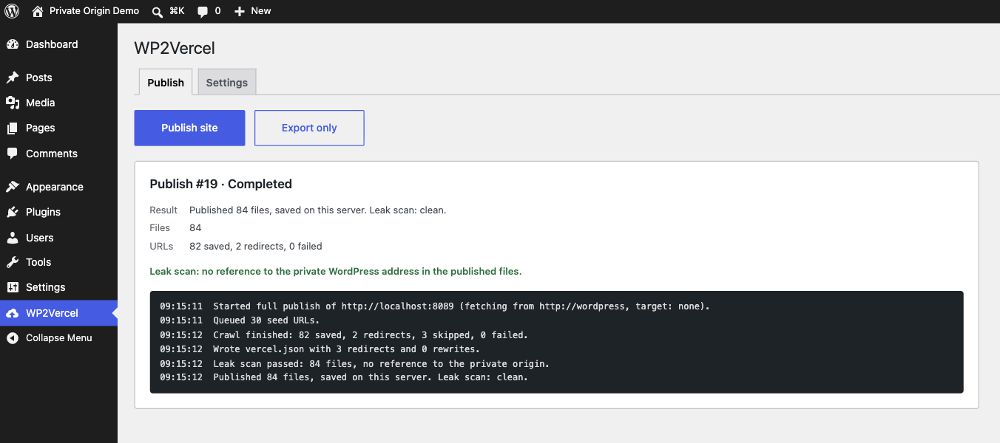
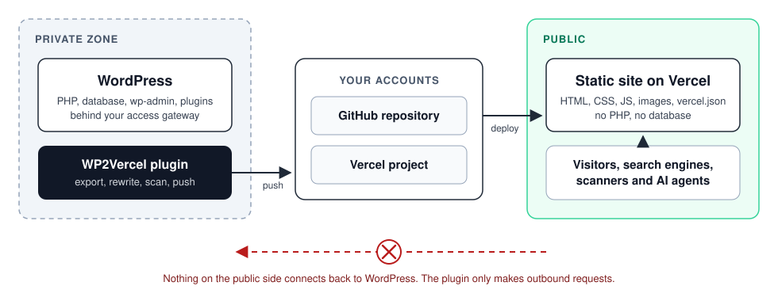
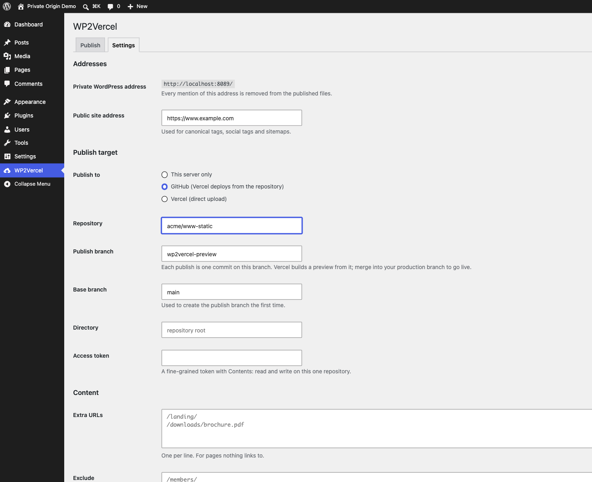

# WP2Vercel

WordPress は非公開のまま、静的サイトを Vercel で公開。

[](https://github.com/tentenco/wp2vercel/actions/workflows/ci.yml)
[](../LICENSE)


[English](../README.md) · [繁體中文](README.zh-Hant.md) · [简体中文](README.zh-Hans.md) · 日本語 · [한국어](README.ko.md)

正本は[英語版 README](../README.md) であり、この翻訳は更新が遅れている場合があります。

WP2Vercel は WordPress プラグインです。サイトを静的ファイルとして書き出し、自分が所有する GitHub リポジトリまたは Vercel プロジェクトに公開します。訪問者、検索エンジン、スキャナー、AI エージェントがアクセスするのは、この静的コピーです。WordPress、PHP、データベース、ログインページはプライベートネットワークに置いたままにでき、編集者はこれまでどおり作業を続けられます。

このリポジトリには、無料でオープンソースの Community 版が入っています。有料版はこれに機能を追加したもので、[wp2vercel.com/pricing](https://wp2vercel.com/pricing) で説明しています。

> **バージョン 0.2.0。** まずステージング環境のコピーで試し、本番サイトを移行する前に[できないこと](#できないこと)を読んでください。Pro と Team プランは [wp2vercel.com/ja/pricing](https://wp2vercel.com/ja/pricing) で購入できます。



## 仕組み



1. WP2Vercel は、公開済みの投稿、固定ページ、アーカイブをすべてデータベースから列挙し、サーバーの内部から 1 つずつ取得します。どこからもリンクされていないページも書き出します。
2. 各ページとアセットをファイルとして保存します。非公開の WordPress アドレスが出てくる箇所はすべて書き換えます。サイト内リンクはルート相対になり、canonical タグ、ソーシャルタグ、サイトマップには設定した公開アドレスを使います。
3. リダイレクトは `vercel.json` の実際の `301` / `302` ルールになります。WordPress 本体のほか、Redirection、Yoast SEO Premium、Rank Math、Safe Redirect Manager、Simple 301 Redirects から読み取ります。
4. リークスキャンが、完成したファイルに非公開アドレスや公開すべきでない種類のファイルが含まれていないかを確認し、該当するファイルと行を報告します。
5. 結果は GitHub ブランチへの 1 つのコミットとして、または Vercel API 経由のデプロイとして送り出します。行うのはアウトバウンドのリクエストだけなので、WordPress がインターネットからの接続を受け付ける必要はありません。

## 機能

- サイト全体の書き出しと、投稿一覧・固定ページ一覧からの単一ページの公開。
- 公開先は 3 種類: GitHub ブランチ（Vercel がリポジトリからデプロイ）、Vercel への直接デプロイ、サーバー上へのファイル保存のみ。
- GitHub へのプッシュでは、変更されたファイルだけをアップロードし、削除されたファイルを取り除きます。1 回の公開が 1 つのコミットになります。
- リダイレクト、末尾スラッシュの扱い、基本的なセキュリティヘッダーを含む `vercel.json`。
- プレーンな形式、JSON エスケープ形式、URL エンコード形式の非公開アドレスを検出するリークスキャン。
- 再開可能なビルド。バックグラウンド、ブラウザーのタブ、WP-CLI のいずれでも実行できます。タイムアウトで止まったビルドは、止まった位置から再開します。
- 下書き、非公開の投稿、パスワードで保護された投稿は書き出しません。REST API リンク、`xmlrpc.php` リンク、generator タグ、ユーザーサイトマップも同様です。
- アクセストークンは libsodium で暗号化するか、`wp-config.php` に置いてデータベースに保存しないようにできます。
- Composer の依存関係もビルド手順もありません。プラグインは素の PHP と JavaScript ファイル 1 つだけです。

## 要件

- WordPress 6.5 以降
- PHP 8.1 以降
- 「Plain」（URL が `?p=123` になる設定）以外のパーマリンク構造
- 公開する場合: Vercel に接続した GitHub リポジトリ、または Vercel プロジェクトとトークン

## インストール

1. [最新リリース](https://github.com/tentenco/wp2vercel/releases/latest)から `wp2vercel.zip` をダウンロードします。
2. WordPress で **Plugins → Add New Plugin → Upload Plugin**（プラグイン → 新規プラグインを追加 → プラグインのアップロード）を開き、zip を選択して有効化します。

WP-CLI を使う場合:

```bash
wp plugin install https://github.com/tentenco/wp2vercel/releases/latest/download/wp2vercel.zip --activate
```

## クイックスタート

1. **WP2Vercel → Settings** を開き、公開サイトのアドレス（例: `https://www.example.com`）を入力します。
2. 公開先を選び、トークンを追加します。GitHub の場合は、公開先のリポジトリ 1 つだけに *Contents: Read and write* を許可した fine-grained トークンを作成します。
3. サーバーが自分自身の公開アドレスに到達できない場合（Docker 環境やゼロトラストゲートウェイの背後ではよくあります）は、取得用アドレス（fetch address）を `http://localhost` のような到達できるアドレスに設定します。
4. **Save and test connection**（保存して接続をテスト）を選択します。
5. **Publish** タブを開き、**Publish site**（サイトを公開）を選択します。最初の公開が成功するまで、このタブには対応が必要な項目（基本のパーマリンク設定や、サーバーから到達できないアドレスなど）が表示されます。



公開先が GitHub の場合、公開のたびにプレビューブランチ（デフォルトは `wp2vercel-preview`）へコミットが 1 つ作成されます。Vercel はそこからプレビュー URL をビルドします。本番公開の準備ができたら、このブランチを本番ブランチにマージします。

## WP-CLI

```bash
wp wp2vercel publish                    # フル公開
wp wp2vercel publish --post=42,57       # 指定した投稿だけを既存の出力に反映
wp wp2vercel publish --skip-deploy      # 書き出しのみ、プッシュしない
wp wp2vercel publish --fail-on-leak     # スキャンで検出があればエラーで終了
wp wp2vercel status                     # 最近のビルド
wp wp2vercel leaks                      # 直近のビルドの検出結果
wp wp2vercel failures                   # 保存できなかった URL
wp wp2vercel config set production_url https://www.example.com
wp wp2vercel test                       # 公開先への接続をテスト
```

## トークンをデータベースに保存しない

次のいずれかを `wp-config.php` で定義するか、環境変数として設定します。設定画面には、その値が外部で管理されていると表示されます。

```php
define('WP2VERCEL_GITHUB_TOKEN', '…');
define('WP2VERCEL_VERCEL_TOKEN', '…');
define('WP2VERCEL_FETCH_BASIC_AUTH_PASSWORD', '…');
```

## できないこと

静的コピーにすると、PHP と WordPress プラグインは公開インターネット上からなくなります。ただし、それが役に立つのは WordPress サーバー自体へのアクセスが閉じられている場合だけで、これは自分のネットワークやアクセスゲートウェイで行う作業です。WP2Vercel はその部分を代わりに行いません。

リクエスト時に PHP を必要とする機能は、静的コピーでは動作しなくなります。該当するのは、コメント、ログイン、カート、そして WordPress にデータを送り返すフォームや検索です。これらには代替サービスか、有料版の機能が必要です。

残るリスク:

- WordPress サーバーは引き続きアップデートが必要です。攻撃者は、まずアクセス制御を突破しなければならなくなります。
- 編集者、Git、Vercel、DNS の認証情報の窃取。
- コンテンツ内に保存された悪意のあるスクリプトは、そのまま書き出されます。
- ページに含まれるサードパーティの JavaScript。
- フォーム、検索、会員機能のために追加する API は、どれも新たに保護が必要な攻撃対象領域になります。

このリリースの制限:

- GitHub と Vercel への公開処理は、ドキュメントに記載された API レスポンスに対する自動テストでカバーしています。幅広い実アカウントでの検証はまだ行っていません。
- マルチサイト、サブディレクトリに設置した WordPress、WPML と Polylang、ページビルダーを使った大規模サイトはテストしていません。
- Vercel が `vercel.json` で受け付けるルートは 2,048 件までです。リダイレクトがこれを超えると、プラグインが警告します。

## エディション

| | Community（このリポジトリ） | 有料版 |
| --- | --- | --- |
| サイト全体と単一ページの静的書き出し | あり | あり |
| GitHub または Vercel への公開 | あり | あり |
| `vercel.json` へのリダイレクトの書き出し | あり | あり |
| 非公開アドレスのリークスキャン | 報告 | 報告に加えて公開の停止も可能 |
| 変更されたページだけを、スケジュールまたは編集後に公開 | | あり |
| より広いスキャンルール: REST API リンク、投稿者アーカイブ、バージョン文字列 | | あり |
| 公開履歴とロールバック | | あり |
| 静的サイト上の検索 | | あり |
| 静的サイト上のフォーム | | あり |
| Polylang と WPML の多言語サイト、ブラウザーの言語によるリダイレクト | | あり |
| アップロードしたメディアを S3 互換ストレージに保存 | | あり |
| デプロイ前の承認、トークンのチェック、監査ログ | | あり |
| 別のフロントエンド向けにコンテンツを JSON で書き出し（ヘッドレス） | | あり |
| サポート | GitHub Issues | メール |

プランとそれぞれの内容は [wp2vercel.com/pricing](https://wp2vercel.com/pricing) に掲載しています。

## 開発

```bash
git clone https://github.com/tentenco/wp2vercel.git
cd wp2vercel

# Docker 上の PHP 8.1〜8.4 ですべてのチェックを実行
bin/ci.sh

# 手元の PHP でユニットテスト（PHP 8.1 以降、PHPUnit 10 以降、HTML API 用に WordPress のチェックアウトが必要）
(cd wp2vercel && WP_CORE_DIR=/path/to/wordpress phpunit)

# ローカルの WordPress を http://localhost:8089 で起動（admin / admin）
docker compose -f dev/docker-compose.yml up -d
dev/seed.sh
dev/wp wp2vercel publish
```

プラグイン本体は [`wp2vercel/`](../wp2vercel) にあります。拡張用のフィルターとアクションは [hooks.md](hooks.md) にまとめています。

## コントリビューションとサポート

- バグ報告と機能要望: [GitHub Issues](https://github.com/tentenco/wp2vercel/issues)
- コントリビュートの方法: [CONTRIBUTING.md](../CONTRIBUTING.md)
- セキュリティに関する報告: [SECURITY.md](../SECURITY.md)。脆弱性については公開 issue を作成しないでください。
- ヘルプの入手先: [SUPPORT.md](../SUPPORT.md)

## ライセンス

WP2Vercel はフリーソフトウェアであり、[GNU General Public License バージョン 2 またはそれ以降](../LICENSE)のもとで公開しています。

WP2Vercel は [Tenten](https://tenten.co) が開発しています。独立したプロジェクトであり、Vercel Inc.、Automattic Inc.、WordPress Foundation のいずれとも提携関係になく、承認や後援も受けていません。Vercel は Vercel Inc. の商標です。WordPress は WordPress Foundation の商標です。
