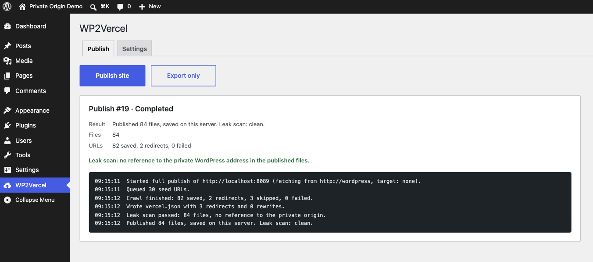
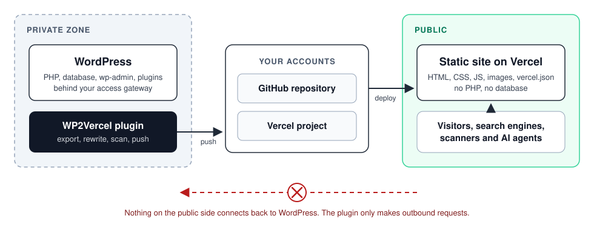
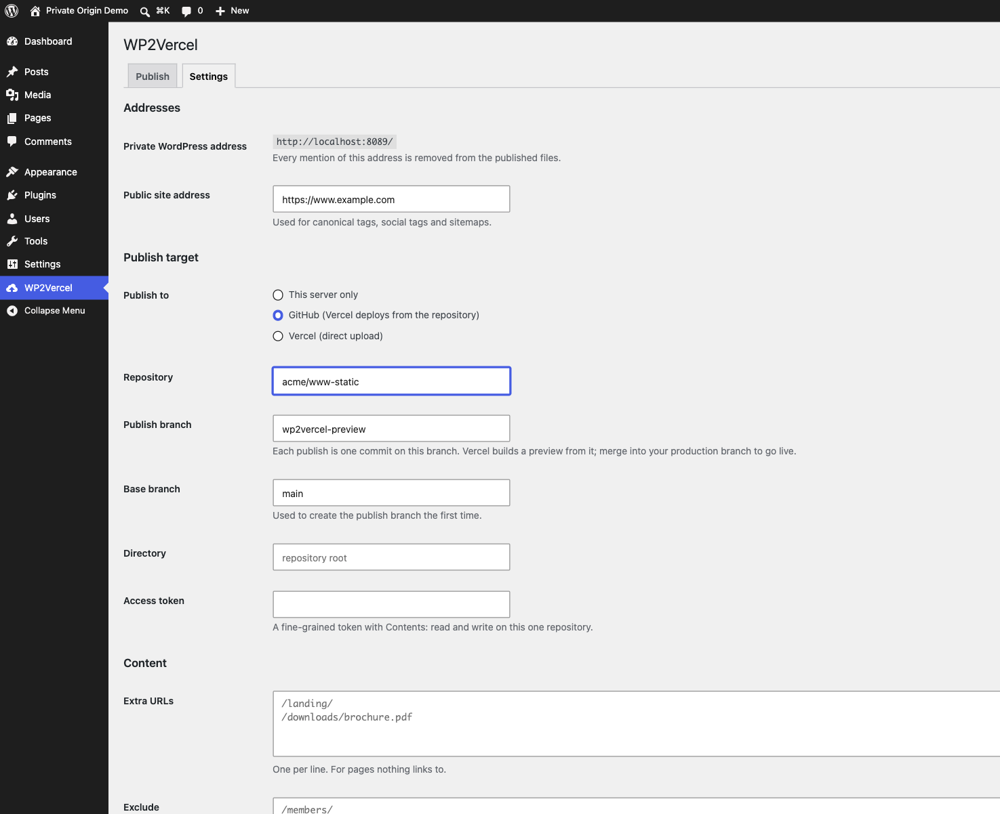

# WP2Vercel

WordPress는 비공개로, 정적 사이트는 Vercel에.

[](https://github.com/tentenco/wp2vercel/actions/workflows/ci.yml)
[](../LICENSE)


[English](../README.md) · [繁體中文](README.zh-Hant.md) · [简体中文](README.zh-Hans.md) · [日本語](README.ja.md) · 한국어

[영문 README](../README.md)가 기준 문서이며, 이 번역은 최신 내용을 뒤늦게 반영할 수 있습니다.

WP2Vercel은 WordPress 플러그인입니다. 사이트를 정적 파일로 내보내 직접 소유한 GitHub 저장소나 Vercel 프로젝트에 게시합니다. 방문자, 검색 엔진, 스캐너, AI 에이전트는 이 정적 사본에 접속합니다. WordPress, PHP, 데이터베이스, 로그인 페이지는 사설 네트워크에 그대로 둘 수 있고, 편집자는 지금까지 하던 방식대로 작업하면 됩니다.

이 저장소에는 무료 오픈소스인 Community 에디션이 들어 있습니다. 유료 에디션은 여기에 기능을 더한 것으로, [wp2vercel.com/pricing](https://wp2vercel.com/pricing)에서 설명합니다.

> **상태: 얼리 액세스.** 버전 0.1.0은 첫 개발 릴리스입니다. 먼저 스테이징 사본에서 사용해 보고, 운영 사이트를 옮기기 전에 [하지 않는 일](#하지-않는-일)을 읽어 보시기 바랍니다.



## 작동 방식



1. WP2Vercel은 게시된 모든 글, 페이지, 아카이브를 데이터베이스에서 나열한 뒤 서버 내부에서 하나씩 가져옵니다. 어디에서도 링크되지 않은 페이지도 내보냅니다.
2. 각 페이지와 에셋을 파일로 저장합니다. 비공개 WordPress 주소가 나오는 곳은 모두 다시 씁니다. 사이트 내부 링크는 루트 상대 경로가 되고, canonical 태그, 소셜 태그, 사이트맵에는 설정한 공개 주소를 사용합니다.
3. 리디렉션은 `vercel.json`의 실제 `301`, `302` 규칙이 됩니다. WordPress 자체와 Redirection, Yoast SEO Premium, Rank Math, Safe Redirect Manager, Simple 301 Redirects에서 읽어 옵니다.
4. 유출 검사가 완성된 파일에서 비공개 주소와 공개되면 안 되는 파일 유형을 찾고, 해당 파일과 줄을 보고합니다.
5. 결과물은 GitHub 브랜치의 커밋 하나로, 또는 Vercel API를 통한 배포로 내보냅니다. 아웃바운드 요청만 보내므로 WordPress가 인터넷에서 들어오는 연결을 받을 필요가 없습니다.

## 기능

- 사이트 전체 내보내기, 그리고 글 목록과 페이지 목록에서 하는 단일 페이지 게시.
- 게시 대상 세 가지: GitHub 브랜치(Vercel이 저장소에서 배포), Vercel 직접 배포, 서버에만 파일 저장.
- GitHub 푸시는 변경된 파일만 업로드하고 삭제된 파일은 제거하며, 게시 한 번이 커밋 하나가 됩니다.
- 리디렉션, 후행 슬래시 동작, 기본 보안 헤더를 담은 `vercel.json`.
- 일반 텍스트, JSON 이스케이프, URL 인코딩 형태의 비공개 주소를 찾는 유출 검사.
- 이어서 실행할 수 있는 빌드. 백그라운드, 브라우저 탭, WP-CLI에서 실행됩니다. 타임아웃으로 멈춘 빌드는 멈춘 지점부터 다시 진행합니다.
- 임시글, 비공개 글, 비밀번호로 보호된 글은 제외됩니다. REST API 링크, `xmlrpc.php` 링크, generator 태그, 사용자 사이트맵도 제외됩니다.
- 액세스 토큰은 libsodium으로 암호화하거나, `wp-config.php`에 두어 데이터베이스에 저장하지 않습니다.
- Composer 의존성도 빌드 단계도 없습니다. 플러그인은 순수 PHP와 JavaScript 파일 하나로 되어 있습니다.

## 요구 사항

- WordPress 6.5 이상
- PHP 8.1 이상
- "Plain"(주소가 `?p=123` 형태인 설정)이 아닌 고유주소 구조
- 게시할 때: Vercel에 연결된 GitHub 저장소, 또는 Vercel 프로젝트와 토큰

## 설치

1. [최신 릴리스](https://github.com/tentenco/wp2vercel/releases/latest)에서 `wp2vercel.zip`을 내려받습니다.
2. WordPress에서 **Plugins → Add New Plugin → Upload Plugin**(플러그인 → 새 플러그인 추가 → 플러그인 업로드)을 열고 zip 파일을 선택한 뒤 활성화합니다.

WP-CLI를 사용하는 경우:

```bash
wp plugin install https://github.com/tentenco/wp2vercel/releases/latest/download/wp2vercel.zip --activate
```

## 빠른 시작

1. **WP2Vercel → Settings**를 열고 공개 사이트 주소(예: `https://www.example.com`)를 입력합니다.
2. 게시할 곳을 선택하고 토큰을 추가합니다. GitHub를 사용한다면 게시할 저장소 하나에만 *Contents: Read and write* 권한을 준 fine-grained 토큰을 만듭니다.
3. 서버가 자신의 공개 주소에 접근할 수 없다면(Docker 환경이나 제로 트러스트 게이트웨이 뒤에서 흔한 경우입니다) 가져오기 주소(fetch address)를 `http://localhost`처럼 서버가 접근할 수 있는 주소로 설정합니다.
4. **Save and test connection**(저장 및 연결 테스트)을 선택합니다.
5. **Publish** 탭을 열고 **Publish site**(사이트 게시)를 선택합니다.



GitHub 대상을 사용하면 게시할 때마다 미리보기 브랜치(기본값 `wp2vercel-preview`)에 커밋이 하나 생깁니다. Vercel은 이 브랜치로 미리보기 URL을 빌드합니다. 실제로 공개할 준비가 되면 이 브랜치를 프로덕션 브랜치에 병합합니다.

## WP-CLI

```bash
wp wp2vercel publish                    # 전체 게시
wp wp2vercel publish --post=42,57       # 지정한 글만 기존 출력에 반영
wp wp2vercel publish --skip-deploy      # 푸시 없이 내보내기만
wp wp2vercel publish --fail-on-leak     # 검사에서 발견된 항목이 있으면 오류로 종료
wp wp2vercel status                     # 최근 빌드
wp wp2vercel leaks                      # 마지막 빌드의 검사 결과
wp wp2vercel failures                   # 저장하지 못한 URL
wp wp2vercel config set production_url https://www.example.com
wp wp2vercel test                       # 게시 대상 연결 테스트
```

## 토큰을 데이터베이스에 저장하지 않기

아래 상수 중 필요한 것을 `wp-config.php`에 정의하거나 환경 변수로 설정합니다. 그러면 설정 화면에 해당 값이 외부에서 관리된다고 표시됩니다.

```php
define('WP2VERCEL_GITHUB_TOKEN', '…');
define('WP2VERCEL_VERCEL_TOKEN', '…');
define('WP2VERCEL_FETCH_BASIC_AUTH_PASSWORD', '…');
```

## 하지 않는 일

정적 사본을 쓰면 PHP와 WordPress 플러그인이 공개 인터넷에서 빠집니다. 다만 이것은 WordPress 서버 자체가 잠겨 있을 때만 도움이 되며, 그 작업은 직접 운영하는 네트워크나 액세스 게이트웨이로 해야 합니다. WP2Vercel이 그 부분을 대신해 주지는 않습니다.

요청 시점에 PHP가 필요한 기능은 정적 사본에서 동작하지 않습니다. 댓글, 로그인, 장바구니, 그리고 WordPress로 데이터를 다시 보내는 폼이나 검색이 여기에 해당합니다. 이런 기능에는 대체 서비스나 유료 에디션 기능이 필요합니다.

남는 위험:

- WordPress 서버는 여전히 업데이트가 필요합니다. 이제 공격자는 먼저 액세스 제어를 통과해야 합니다.
- 편집자, Git, Vercel, DNS 자격 증명 탈취.
- 콘텐츠에 저장된 악성 스크립트는 그대로 내보내집니다.
- 페이지에 포함된 서드파티 JavaScript.
- 폼, 검색, 멤버십을 위해 추가하는 API는 모두 새로 보호해야 할 공격 표면입니다.

이번 릴리스의 한계:

- GitHub 및 Vercel 게시 기능은 문서화된 API 응답을 기준으로 한 자동화 테스트로 검증합니다. 다양한 실제 계정에서는 아직 검증하지 못했습니다.
- 멀티사이트, 하위 디렉터리에 설치한 WordPress, WPML과 Polylang, 페이지 빌더를 쓰는 대규모 사이트는 테스트하지 않았습니다.
- Vercel은 `vercel.json`에서 경로(route)를 2,048개까지 허용합니다. 리디렉션이 이를 넘으면 플러그인이 경고합니다.

## 에디션

| | Community(이 저장소) | 유료 에디션 |
| --- | --- | --- |
| 사이트 전체 및 단일 페이지 정적 내보내기 | 예 | 예 |
| GitHub 또는 Vercel에 게시 | 예 | 예 |
| 리디렉션을 `vercel.json`으로 내보내기 | 예 | 예 |
| 비공개 주소 유출 검사 | 보고 | 보고하고 게시를 중단할 수 있음 |
| 변경된 페이지만 게시(예약 또는 편집 후) | | 예 |
| 더 넓은 검사 규칙: REST API 링크, 글쓴이 아카이브, 버전 문자열 | | 예 |
| 게시 기록과 롤백 | | 예 |
| 정적 사이트 검색 | | 예 |
| 지원 | GitHub Issues | 이메일 |

요금제와 각 요금제에 포함된 내용은 [wp2vercel.com/pricing](https://wp2vercel.com/pricing)에 나와 있습니다.

## 개발

```bash
git clone https://github.com/tentenco/wp2vercel.git
cd wp2vercel

# 단위 테스트(PHP 8.1 이상, PHPUnit 10 이상, HTML API용 WordPress 체크아웃 필요)
cd wp2vercel && WP_CORE_DIR=/path/to/wordpress phpunit

# http://localhost:8089 에서 실행되는 로컬 WordPress(admin / admin)
docker compose -f dev/docker-compose.yml up -d
dev/seed.sh
dev/wp wp2vercel publish
```

플러그인은 [`wp2vercel/`](../wp2vercel)에 있습니다. 확장에 쓰는 필터와 액션은 [hooks.md](hooks.md)에 정리되어 있습니다.

## 기여 및 지원

- 버그와 기능 요청: [GitHub Issues](https://github.com/tentenco/wp2vercel/issues)
- 기여 방법: [CONTRIBUTING.md](../CONTRIBUTING.md)
- 보안 제보: [SECURITY.md](../SECURITY.md). 취약점은 공개 이슈로 올리지 말아 주십시오.
- 도움을 받을 곳: [SUPPORT.md](../SUPPORT.md)

## 라이선스

WP2Vercel은 자유 소프트웨어이며 [GNU 일반 공중 사용 허가서 버전 2 또는 그 이후 버전](../LICENSE)으로 배포됩니다.

WP2Vercel은 [Tenten](https://tenten.co)이 만듭니다. 독립 프로젝트이며 Vercel Inc., Automattic Inc., WordPress Foundation과 제휴 관계가 없고 이들의 보증이나 후원을 받지 않습니다. Vercel은 Vercel Inc.의 상표입니다. WordPress는 WordPress Foundation의 상표입니다.
