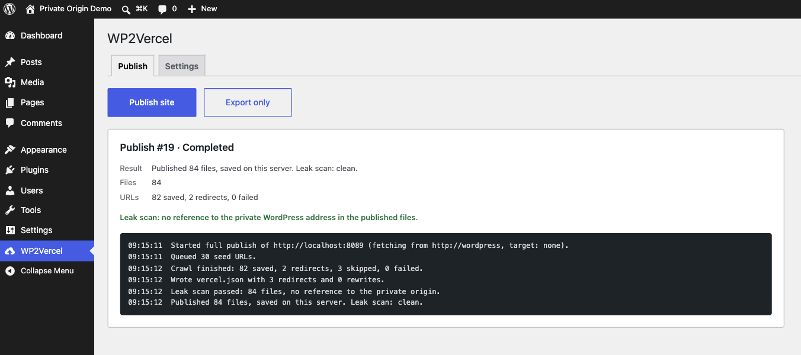
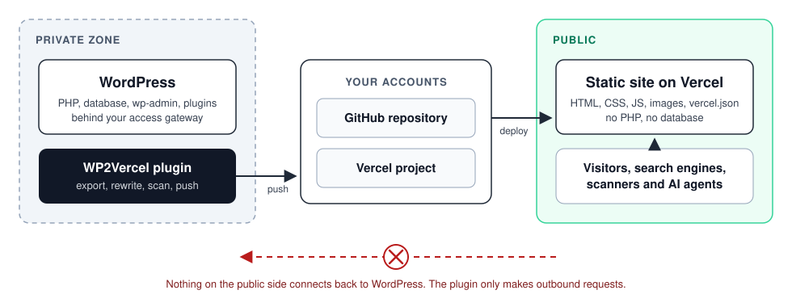
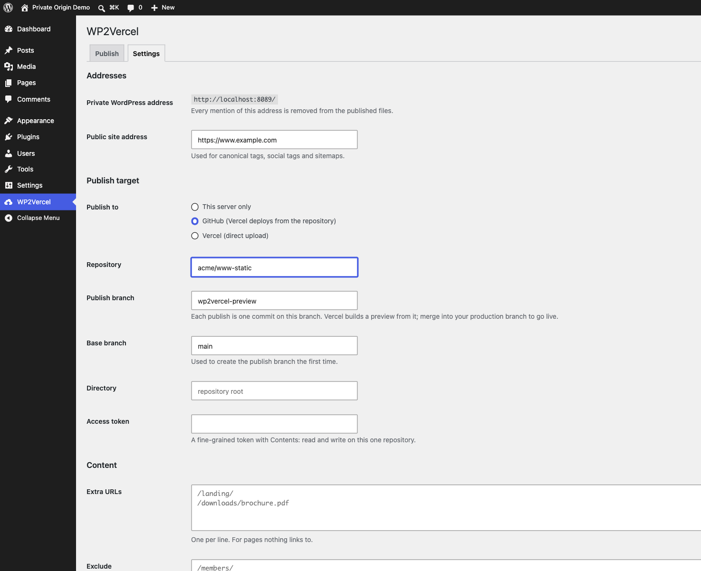

# WP2Vercel

WordPress 不对外，静态站点上 Vercel。

[](https://github.com/tentenco/wp2vercel/actions/workflows/ci.yml)
[](../LICENSE)


[English](../README.md) · [繁體中文](README.zh-Hant.md) · 简体中文 · [日本語](README.ja.md) · [한국어](README.ko.md)

内容以[英文版 README](../README.md) 为准，本译文的更新可能滞后。

WP2Vercel 是一款 WordPress 插件。它把你的站点导出为静态文件，并发布到你自己的 GitHub 仓库或 Vercel 项目。访问者、搜索引擎、扫描器和 AI 智能体访问到的都是这份静态副本。WordPress、PHP、数据库和登录页面可以留在私有网络中，编辑人员照常工作即可。

本仓库存放的是免费、开源的 Community 版。付费版在此基础上增加功能，详见 [wp2vercel.com/pricing](https://wp2vercel.com/pricing)。

> **状态：早期试用（early access）。** 0.1.0 是第一个开发版本。请先在预发布（staging）副本上试用，并在迁移生产站点之前阅读[这个插件不做的事](#这个插件不做的事)。



## 工作原理



1. WP2Vercel 从数据库列出所有已发布的文章、页面和归档页，再从服务器内部逐个抓取。没有任何链接指向的页面也会导出。
2. 每个页面和资源都保存为文件。所有出现 WordPress 私有地址的地方都会被改写。站内链接改为根相对路径，canonical 标签、社交标签和站点地图使用你设置的公开地址。
3. 重定向会成为 `vercel.json` 中真正的 `301` 和 `302` 规则，来源包括 WordPress 本身，以及 Redirection、Yoast SEO Premium、Rank Math、Safe Redirect Manager 和 Simple 301 Redirects。
4. 泄露扫描会检查生成的文件，查找私有地址和不应公开的文件类型，并报告所在的文件和行号。
5. 结果以 GitHub 分支上的一次提交发出，或通过 Vercel API 创建一次部署。整个过程只发起出站请求，因此 WordPress 不需要接受来自互联网的连接。

## 功能

- 整站导出，也可以在“文章”和“页面”列表中发布单个页面。
- 三种发布目标：GitHub 分支（由 Vercel 从仓库部署）、直接部署到 Vercel，或只把文件保存在服务器上。
- 推送到 GitHub 时只上传有变更的文件，并移除已删除的文件，每次发布对应一次提交。
- 生成 `vercel.json`，包含重定向、尾部斜杠行为和基本的安全响应头。
- 泄露扫描可检查纯文本、JSON 转义和 URL 编码三种形式的私有地址。
- 可续跑的构建，可以在后台、浏览器标签页或 WP-CLI 中运行。构建因超时中断后，会从停下的位置继续。
- 草稿、私密文章和受密码保护的文章不会导出。REST API 链接、`xmlrpc.php` 链接、generator 标签和用户站点地图也会被排除。
- 访问令牌使用 libsodium 加密，或者放在 `wp-config.php` 中，不写入数据库。
- 没有 Composer 依赖，也没有构建步骤。插件只有纯 PHP 和一个 JavaScript 文件。

## 环境要求

- WordPress 6.5 或更高版本
- PHP 8.1 或更高版本
- 固定链接结构不能是“Plain”（网址带 `?p=123` 的那一种）
- 发布时需要：已连接 Vercel 的 GitHub 仓库，或一个 Vercel 项目和令牌

## 安装

1. 从[最新发布版本](https://github.com/tentenco/wp2vercel/releases/latest)下载 `wp2vercel.zip`。
2. 在 WordPress 中打开 **Plugins → Add New Plugin → Upload Plugin**（插件的上传安装页面），选择该 zip 文件并启用插件。

使用 WP-CLI：

```bash
wp plugin install https://github.com/tentenco/wp2vercel/releases/latest/download/wp2vercel.zip --activate
```

## 快速开始

1. 打开 **WP2Vercel → Settings**，填写公开的站点地址，例如 `https://www.example.com`。
2. 选择发布位置并添加令牌。使用 GitHub 时，请创建细粒度令牌（fine-grained token），只对你要发布的那一个仓库授予 *Contents: Read and write* 权限。
3. 如果服务器无法访问自己的公开地址（在 Docker 中或零信任网关之后很常见），请把抓取地址（fetch address）设为服务器能访问的地址，例如 `http://localhost`。
4. 点击 **Save and test connection**（保存并测试连接）。
5. 打开 **Publish** 标签页，点击 **Publish site**（发布站点）。



使用 GitHub 目标时，每次发布都是预览分支（默认为 `wp2vercel-preview`）上的一次提交，Vercel 会用它构建预览 URL。准备上线时，再把该分支合并到生产分支。

## WP-CLI

```bash
wp wp2vercel publish                    # 完整发布
wp wp2vercel publish --post=42,57       # 只发布这些文章，写入现有输出
wp wp2vercel publish --skip-deploy      # 只导出，不推送
wp wp2vercel publish --fail-on-leak     # 扫描有发现时以错误退出
wp wp2vercel status                     # 最近的构建
wp wp2vercel leaks                      # 上一次构建的扫描结果
wp wp2vercel failures                   # 未能保存的 URL
wp wp2vercel config set production_url https://www.example.com
wp wp2vercel test                       # 测试与发布目标的连接
```

## 不把令牌存入数据库

在 `wp-config.php` 中定义以下任一常量，或将其设为环境变量。设置界面会显示该值由外部管理。

```php
define('WP2VERCEL_GITHUB_TOKEN', '…');
define('WP2VERCEL_VERCEL_TOKEN', '…');
define('WP2VERCEL_FETCH_BASIC_AUTH_PASSWORD', '…');
```

## 这个插件不做的事

静态副本让 PHP 和 WordPress 插件不再出现在公共互联网上。但这只有在 WordPress 服务器本身已经锁定的前提下才有用，而锁定要靠你自己的网络或访问网关来完成。WP2Vercel 不会替你做这一部分。

需要在请求时运行 PHP 的功能在静态副本上无法工作：评论、登录、购物车，以及向 WordPress 回传数据的表单或搜索。这些功能需要替代服务，或付费版的功能。

仍然存在的风险：

- WordPress 服务器仍然需要更新。攻击者现在必须先突破你的访问控制。
- 编辑账号、Git、Vercel 或 DNS 的凭据被盗。
- 存储在内容中的恶意脚本会原样导出。
- 页面上的第三方 JavaScript。
- 你为表单、搜索或会员功能添加的任何 API，都是需要保护的新攻击面。

本版本的限制：

- GitHub 和 Vercel 的发布功能有自动化测试覆盖，测试依据是文档中记载的 API 响应。目前还没有在各种不同的真实账号上验证过。
- 多站点（Multisite）、安装在子目录中的 WordPress、WPML 和 Polylang，以及使用页面构建器的大型站点都尚未测试。
- Vercel 的 `vercel.json` 最多接受 2,048 条路由。重定向数量超过时，插件会发出警告。

## 版本对比

| | Community 版（本仓库） | 付费版 |
| --- | --- | --- |
| 整站和单页静态导出 | 有 | 有 |
| 发布到 GitHub 或 Vercel | 有 | 有 |
| 将重定向导出到 `vercel.json` | 有 | 有 |
| 私有地址泄露扫描 | 报告 | 报告，并可中止发布 |
| 只发布有变更的页面，可按计划或在编辑后执行 | | 有 |
| 更多扫描规则：REST API 链接、作者归档页、版本字符串 | | 有 |
| 发布历史和回滚 | | 有 |
| 静态站点上的搜索 | | 有 |
| 支持 | GitHub Issues | 电子邮件 |

各套餐及其包含的内容列在 [wp2vercel.com/pricing](https://wp2vercel.com/pricing)。

## 开发

```bash
git clone https://github.com/tentenco/wp2vercel.git
cd wp2vercel

# 单元测试（需要 PHP 8.1+、PHPUnit 10+，以及一份供 HTML API 使用的 WordPress 源码）
cd wp2vercel && WP_CORE_DIR=/path/to/wordpress phpunit

# 本地 WordPress，地址为 http://localhost:8089（admin / admin）
docker compose -f dev/docker-compose.yml up -d
dev/seed.sh
dev/wp wp2vercel publish
```

插件代码位于 [`wp2vercel/`](../wp2vercel)。用于扩展插件的过滤器（filter）和动作（action）列在 [hooks.md](hooks.md) 中。

## 贡献与支持

- 缺陷报告和功能建议：[GitHub Issues](https://github.com/tentenco/wp2vercel/issues)
- 如何贡献：[CONTRIBUTING.md](../CONTRIBUTING.md)
- 安全报告：[SECURITY.md](../SECURITY.md)。请不要为漏洞创建公开的 issue。
- 获取帮助的途径：[SUPPORT.md](../SUPPORT.md)

## 许可证

WP2Vercel 是自由软件，以 [GNU 通用公共许可证第 2 版或更高版本](../LICENSE)发布。

WP2Vercel 由 [Tenten](https://tenten.co) 开发，是一个独立项目，与 Vercel Inc.、Automattic Inc. 或 WordPress Foundation 没有关联，也未获得其认可或赞助。Vercel 是 Vercel Inc. 的商标。WordPress 是 WordPress Foundation 的商标。
