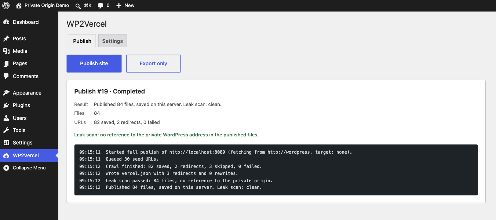
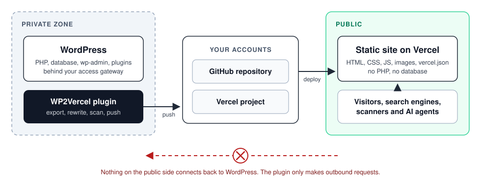
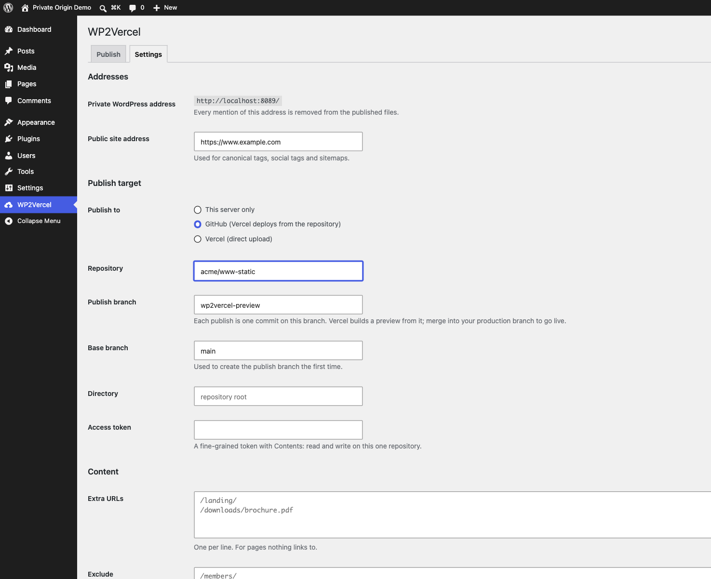

# WP2Vercel

WordPress 不對外，靜態網站上 Vercel。

[](https://github.com/tentenco/wp2vercel/actions/workflows/ci.yml)
[](../LICENSE)


[English](../README.md) · 繁體中文 · [简体中文](README.zh-Hans.md) · [日本語](README.ja.md) · [한국어](README.ko.md)

內容以[英文版 README](../README.md) 為準，這份翻譯的更新可能會比較慢。

WP2Vercel 是一款 WordPress 外掛，會把你的網站匯出成靜態檔案，再發布到你自己擁有的 GitHub 儲存庫或 Vercel 專案。訪客、搜尋引擎、掃描工具和 AI 代理程式接觸到的都是這份靜態副本。WordPress、PHP、資料庫和登入頁面可以留在私有網路裡，編輯人員照原本的方式工作即可。

這個儲存庫收錄的是免費、開放原始碼的 Community 版。付費版在這個基礎上增加功能，說明請見 [wp2vercel.com/pricing](https://wp2vercel.com/pricing)。

> **狀態：早期試用（early access）。** 0.1.0 是第一個開發版本。請先在測試站（staging）的副本上試用，並在搬移正式站之前讀過[這個外掛不做的事](#這個外掛不做的事)。



## 運作方式



1. WP2Vercel 從資料庫列出所有已發布的文章、頁面和彙整頁，再從伺服器內部逐一擷取。沒有任何連結指向的頁面也會匯出。
2. 每個頁面和資源都會儲存成檔案。所有出現 WordPress 私有網址的地方都會改寫。站內連結改為根相對路徑，canonical 標籤、社群標籤和網站地圖（sitemap）則使用你設定的公開網址。
3. 轉址會成為 `vercel.json` 裡真正的 `301` 和 `302` 規則，來源是 WordPress 本身，以及 Redirection、Yoast SEO Premium、Rank Math、Safe Redirect Manager 和 Simple 301 Redirects。
4. 洩漏掃描會檢查產出的檔案，找出私有網址和不該公開的檔案類型，並回報所在的檔案與行號。
5. 成果會以 GitHub 分支上的一個 commit 送出，或透過 Vercel API 建立一次部署。過程中只會發出對外請求，所以 WordPress 不必接受來自網際網路的連線。

## 功能

- 全站匯出，也可以從「文章」和「頁面」清單發布單一頁面。
- 三種發布目標：GitHub 分支（由 Vercel 從儲存庫部署）、直接部署到 Vercel，或只把檔案留在伺服器上。
- 推送到 GitHub 時只上傳有變更的檔案，並移除已刪除的檔案，每次發布是一個 commit。
- 產生 `vercel.json`，內含轉址、結尾斜線行為和基本的安全性標頭。
- 洩漏掃描可找出純文字、JSON 跳脫和 URL 編碼三種形式的私有網址。
- 可接續的建置，能在背景、瀏覽器分頁或 WP-CLI 中執行。建置因逾時中斷後，會從停下的地方繼續。
- 草稿、私密文章和受密碼保護的文章不會匯出。REST API 連結、`xmlrpc.php` 連結、generator 標籤和使用者網站地圖也一併排除。
- 存取權杖以 libsodium 加密，或改放在 `wp-config.php`，不存進資料庫。
- 沒有 Composer 相依套件，也不需要建置步驟。外掛只有純 PHP 和一個 JavaScript 檔案。

## 系統需求

- WordPress 6.5 以上
- PHP 8.1 以上
- 永久連結結構不能是「Plain」（網址帶 `?p=123` 的那一種）
- 發布時需要：已連接 Vercel 的 GitHub 儲存庫，或一個 Vercel 專案和權杖

## 安裝

1. 從[最新版本](https://github.com/tentenco/wp2vercel/releases/latest)下載 `wp2vercel.zip`。
2. 在 WordPress 中開啟 **Plugins → Add New Plugin → Upload Plugin**（外掛 → 安裝外掛 → 上傳外掛），選擇這個 zip 檔並啟用外掛。

使用 WP-CLI：

```bash
wp plugin install https://github.com/tentenco/wp2vercel/releases/latest/download/wp2vercel.zip --activate
```

## 快速上手

1. 開啟 **WP2Vercel → Settings**，輸入公開的網站網址，例如 `https://www.example.com`。
2. 選擇發布位置並加入權杖。使用 GitHub 時，請建立 fine-grained 權杖，只針對你要發布的那一個儲存庫授予 *Contents: Read and write* 權限。
3. 如果伺服器連不到自己的公開網址（在 Docker 裡或零信任閘道後方很常見），請把擷取網址（fetch address）設成伺服器連得到的位址，例如 `http://localhost`。
4. 按下 **Save and test connection**（儲存並測試連線）。
5. 開啟 **Publish** 分頁，按下 **Publish site**（發布網站）。



使用 GitHub 目標時，每次發布都是預覽分支（預設為 `wp2vercel-preview`）上的一個 commit，Vercel 會用它建置出預覽網址。準備好上線時，再把這個分支合併到正式分支。

## WP-CLI

```bash
wp wp2vercel publish                    # 完整發布
wp wp2vercel publish --post=42,57       # 只發布這些文章，寫入現有的輸出
wp wp2vercel publish --skip-deploy      # 只匯出，不推送
wp wp2vercel publish --fail-on-leak     # 掃描有發現時以錯誤結束
wp wp2vercel status                     # 最近的建置
wp wp2vercel leaks                      # 上一次建置的掃描結果
wp wp2vercel failures                   # 無法儲存的網址
wp wp2vercel config set production_url https://www.example.com
wp wp2vercel test                       # 測試與發布目標的連線
```

## 不把權杖存進資料庫

在 `wp-config.php` 裡定義下列任一常數，或設成環境變數。設定畫面會顯示該值由外部管理。

```php
define('WP2VERCEL_GITHUB_TOKEN', '…');
define('WP2VERCEL_VERCEL_TOKEN', '…');
define('WP2VERCEL_FETCH_BASIC_AUTH_PASSWORD', '…');
```

## 這個外掛不做的事

靜態副本讓 PHP 和 WordPress 外掛不再出現在公開網際網路上。但這只有在 WordPress 伺服器本身已經鎖好的情況下才有幫助，而這要靠你自己的網路或存取閘道來做。WP2Vercel 不會替你處理這一部分。

需要在請求當下執行 PHP 的功能，在靜態副本上無法運作：留言、登入、購物車，以及會把資料送回 WordPress 的表單或搜尋。這些功能需要替代服務，或付費版的功能。

仍然存在的風險：

- WordPress 伺服器仍然需要更新。攻擊者現在必須先通過你的存取控制。
- 編輯帳號、Git、Vercel 或 DNS 的憑證遭竊。
- 儲存在內容裡的惡意指令碼會原封不動匯出。
- 頁面上的第三方 JavaScript。
- 你為表單、搜尋或會員功能加上的任何 API，都是需要保護的新攻擊面。

這個版本的限制：

- GitHub 和 Vercel 的發布功能有自動化測試，測試依據是文件記載的 API 回應。目前還沒有在各種不同的真實帳號上驗證過。
- 多站網路（Multisite）、安裝在子目錄的 WordPress、WPML 和 Polylang，以及使用頁面編輯器（page builder）的大型網站都尚未測試。
- Vercel 的 `vercel.json` 最多接受 2,048 條路由。轉址數量超過時，外掛會提出警告。

## 版本比較

| | Community 版（本儲存庫） | 付費版 |
| --- | --- | --- |
| 全站和單頁靜態匯出 | 有 | 有 |
| 發布到 GitHub 或 Vercel | 有 | 有 |
| 將轉址匯出到 `vercel.json` | 有 | 有 |
| 私有網址洩漏掃描 | 回報 | 回報，並可中止發布 |
| 只發布有變更的頁面，可排程或在編輯後執行 | | 有 |
| 更多掃描規則：REST API 連結、作者彙整頁、版本字串 | | 有 |
| 發布紀錄與還原（rollback） | | 有 |
| 靜態網站上的搜尋 | | 有 |
| 支援 | GitHub Issues | Email |

各方案和內容列在 [wp2vercel.com/pricing](https://wp2vercel.com/pricing)。

## 開發

```bash
git clone https://github.com/tentenco/wp2vercel.git
cd wp2vercel

# 單元測試（需要 PHP 8.1+、PHPUnit 10+，以及一份 WordPress 原始碼供 HTML API 使用）
cd wp2vercel && WP_CORE_DIR=/path/to/wordpress phpunit

# 本機 WordPress，位於 http://localhost:8089（admin / admin）
docker compose -f dev/docker-compose.yml up -d
dev/seed.sh
dev/wp wp2vercel publish
```

外掛本體在 [`wp2vercel/`](../wp2vercel)。用來擴充外掛的 filter 和 action 列在 [hooks.md](hooks.md)。

## 貢獻與支援

- 錯誤回報和功能建議：[GitHub Issues](https://github.com/tentenco/wp2vercel/issues)
- 如何貢獻：[CONTRIBUTING.md](../CONTRIBUTING.md)
- 安全性通報：[SECURITY.md](../SECURITY.md)。發現漏洞時請不要開公開的 issue。
- 取得協助的管道：[SUPPORT.md](../SUPPORT.md)

## 授權

WP2Vercel 是自由軟體，以 [GNU 通用公共授權條款第 2 版或更新版本](../LICENSE)釋出。

WP2Vercel 由 [Tenten](https://tenten.co) 製作，是獨立專案，與 Vercel Inc.、Automattic Inc. 或 WordPress Foundation 沒有隸屬關係，也未獲其背書或贊助。Vercel 是 Vercel Inc. 的商標。WordPress 是 WordPress Foundation 的商標。
